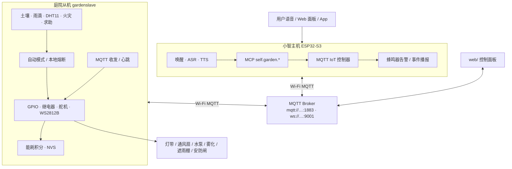
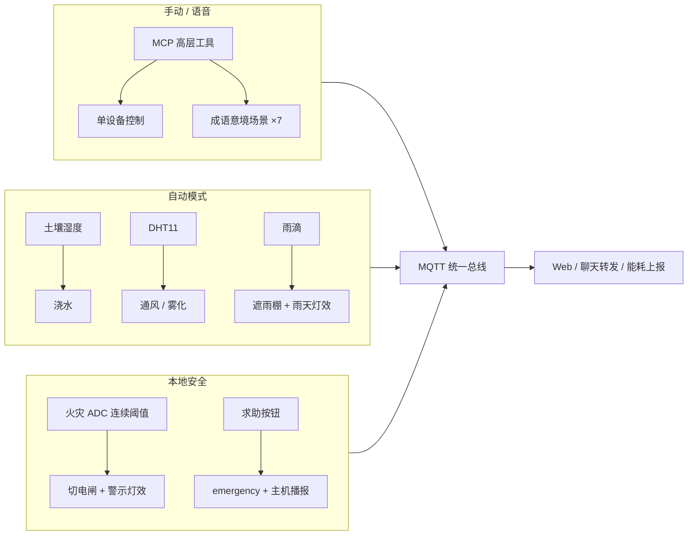

# garden · 小智智慧庭院

基于 **ESP32-S3 小智语音主机** + **ESP32-S3 庭院从机** + **MQTT / MCP / WS2812B** 的智慧庭院系统（论文项目：「云亭智联」AIoT 智慧庭院）。

> 主机负责智能交互，从机负责实时执行与本地安全闭环。

## 系统架构图



## 功能框图



## 设计原则

- 主机不直接接庭院负载；执行器全部在从机
- 安全事件（火灾等）在从机本地闭环，不依赖云端
- 场景管氛围灯效，自动模式管继电器设备，二者正交
- MQTT 是主机、从机、Web、后续 App 的统一协议总线
- MCP 保留高层 `self.garden.*`，降低大模型选错工具概率

## 仓库结构

| 路径 | 说明 |
|------|------|
| `main/` | 小智主机：语音、MCP、garden 工具、MQTT 控制器 |
| `slave/gardenslave/` | 庭院从机：执行器、传感器、自动与能耗 |
| `shared/mqtt_iot_protocol.h` | 主从共用 Topic / 命令码 |
| `web/` | MQTT.js 面板与 control-panel |
| `论文.md` / `演示流程.md` | 论文与演示脚本 |
| `MCU_ENERGY_PROTOCOL(1).md` | 能耗协议 |

## 能力速览

| 能力 | 说明 |
|------|------|
| 语音控制 | `self.garden.*` MCP |
| 意境场景 | 七种成语场景 + 灯效 |
| 自动联动 | 浇水 / 通风雾化 / 遮雨棚 |
| 火灾熔断 | 从机 ADC 连续超阈值本地切断 |
| 求助告警 | 按钮 → MQTT emergency + 主机播报 |
| 能耗追踪 | 功率×时间积分，NVS + MQTT |

## 远程

```text
origin → https://github.com/linxi27667/garden.git
```

本地常见路径：`E:\MCU\esp32\xiaozhi\garden`
